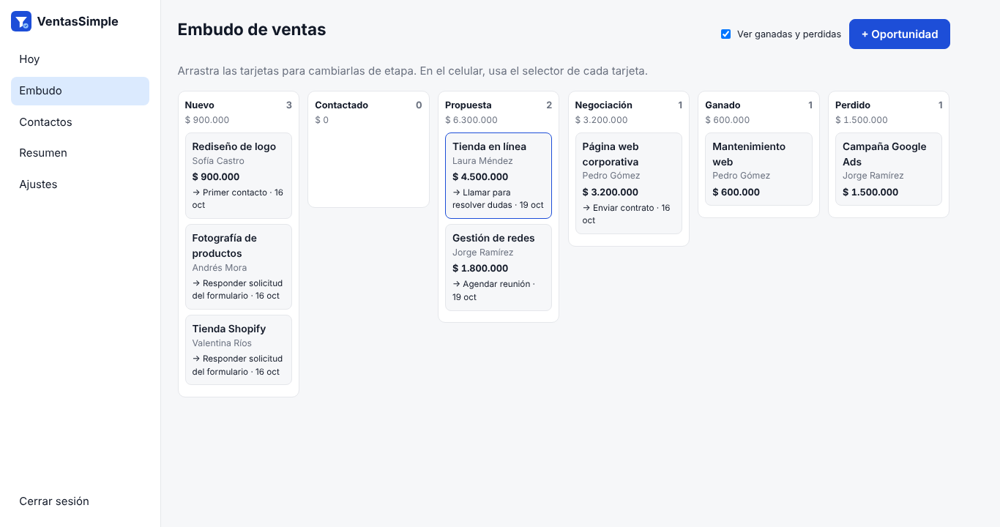
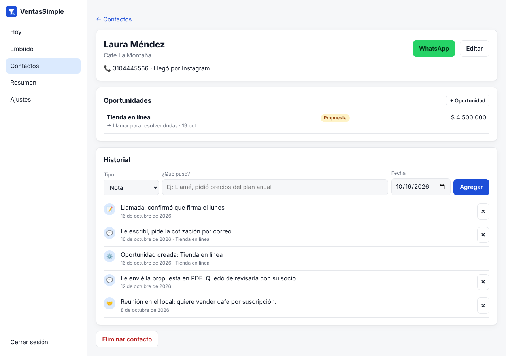

# VentasSimple

Un CRM ligero para pequeños negocios y vendedores independientes de Latinoamérica: tus contactos, tu embudo de ventas y tus seguimientos en un solo lugar. En español, sin mensualidades y en tu propio servidor.

<!-- Cuando Hostinger abra su programa para desarrolladores, pega aquí el botón con tu código de referencia:
[](URL_DE_IMPLEMENTACIÓN_CON_TU_CÓDIGO)
-->



## Qué hace

- **Hoy:** los seguimientos atrasados y los del día, con botón de WhatsApp y un clic para registrar qué pasó y programar el siguiente paso.
- **Embudo de ventas** en tablero: Nuevo → Contactado → Propuesta → Negociación → Ganado o Perdido. Arrastras las tarjetas para cambiarlas de etapa y en el celular usas un selector.
- **Contactos** con empresa, teléfono, email, origen y etiquetas, más búsqueda y filtro por origen.
- **Historial** de cada cliente: notas, llamadas, mensajes de WhatsApp, emails y reuniones. Los cambios de etapa quedan registrados solos.
- **Formulario público de contacto:** lo compartes por enlace o lo pegas en tu web, y cada persona que lo llena entra sola al embudo. Si el teléfono o el email ya existen, se agrega al mismo contacto.
- **Resumen:** valor del embudo, lo ganado en el mes, tasa de cierre y de dónde llegan tus clientes.
- **Exportar contactos a CSV** para abrirlos en Excel o Google Sheets.
- **Copia de seguridad** y restauración en un clic.
- **Sin dependencias:** solo necesita Node.js 18 o superior. No usa base de datos externa.



## Instalación

### Opción 1: Docker (recomendada, ideal para un VPS)

```bash
git clone https://github.com/Gestiiona/ventas-simple.git
cd ventas-simple
cp .env.example .env      # edita ADMIN_PASSWORD
docker compose up -d
```

- Panel: `http://IP-DE-TU-SERVIDOR:3000`
- Formulario público: `http://IP-DE-TU-SERVIDOR:3000/formulario`

### Opción 2: Node.js

```bash
git clone https://github.com/Gestiiona/ventas-simple.git
cd ventas-simple
ADMIN_PASSWORD="tu-contraseña-segura" npm start
```

### Pegar el formulario en tu página web

En **Ajustes** encuentras el enlace y un código listo para copiar, como este:

```html
<iframe src="https://TU-DOMINIO/formulario" style="width:100%;max-width:560px;height:640px;border:0" title="Contáctanos"></iframe>
```

### Variables de entorno

| Variable | Para qué sirve | Por defecto |
|---|---|---|
| `ADMIN_PASSWORD` | Contraseña del panel (mínimo 8 caracteres). **Defínela siempre.** | — |
| `PORT` | Puerto del servidor | `3000` |
| `DATA_DIR` | Carpeta donde se guardan los datos | `./data` |
| `SETUP_CODE` | Código fijo para la configuración inicial, si no usas `ADMIN_PASSWORD` | aleatorio |

**Sin `ADMIN_PASSWORD`**, el panel pide un *código de configuración* que se imprime en los registros (logs) del servidor. Así nadie más puede adueñarse de tu instalación antes que tú.

## Tus datos

Todo se guarda en `data/db.json`.

- **Docker:** los datos viven en el volumen `ventassimple-data` y sobreviven a reinicios y actualizaciones.
- **Hosting administrado (por ejemplo, Web Apps de Node.js):** comprueba que la carpeta de datos se conserve al volver a desplegar. Si no estás seguro, apunta `DATA_DIR` a una carpeta persistente o usa un VPS con Docker.
- **Haz copias de seguridad** desde *Ajustes → Descargar copia*.
- Recibes datos personales de tus clientes: úsalos solo para lo que te autorizaron y cumple la ley de protección de datos de tu país (en Colombia, la Ley 1581 de 2012).

## Seguridad

- Contraseña guardada con `scrypt` y sesión en una cookie firmada `HttpOnly`.
- Límite de intentos de acceso por IP.
- Formulario protegido con campo trampa para bots y límite de envíos por conexión.
- El panel no se puede incrustar en otros sitios; solo el formulario.
- El CSV exportado neutraliza fórmulas para que una celda maliciosa no se ejecute en Excel.
- Usa HTTPS en producción. En un VPS puedes ponerlo detrás de Caddy, Nginx o Traefik.

## Actualizar

```bash
git pull
docker compose up -d --build
```

## Licencia

MIT. Úsala, modifícala y compártela libremente.

Hecho por [Gestiiona](https://gestiiona.com). Revisa también [FacturaSimple](https://github.com/Gestiiona/factura-simple), para cotizaciones y cuentas de cobro, y [AgendaSimple](https://github.com/Gestiiona/agenda-simple), para reservas en línea.
